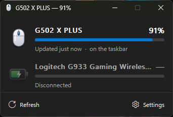
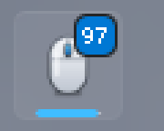
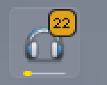
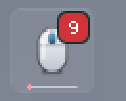
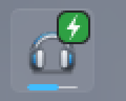
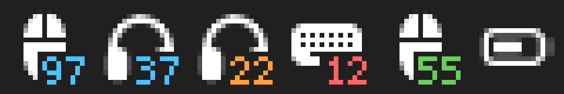
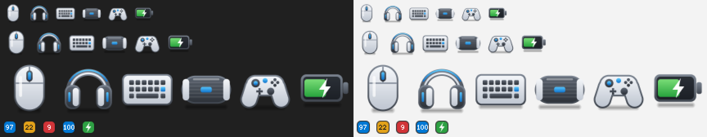
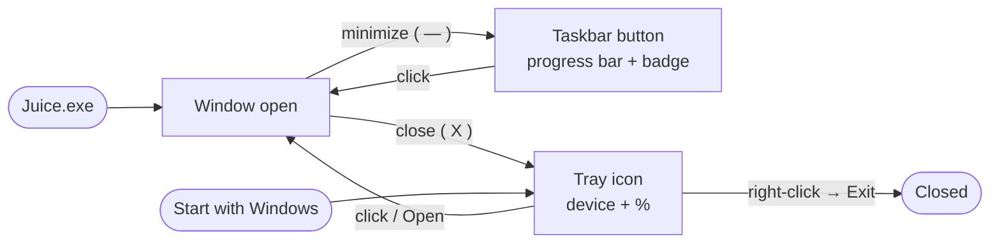

<p align="center">
  <b>English</b> · <a href="README.pt-BR.md">Português (Brasil)</a>
</p>

<p align="center">
  
</p>

<p align="center">
  <b>The battery level of your wireless mouse, keyboard, headset, speaker and controller, right on the Windows taskbar.</b><br>
  No G HUB, no background service, no installer — a single ~370 KB <code>.exe</code>.
</p>

<p align="center">
  <a href="https://github.com/gSalzmann/juice/releases/latest/download/Juice.exe"></a>
  <br><sub>Windows 10/11 x64 · <a href="https://github.com/gSalzmann/juice/releases/latest">release notes</a></sub>
</p>

<p align="center">
  
  
  
  
  <a href="LICENSE"></a>
</p>

---

## Why "Juice"?

**Juice** is slang for *battery charge* — *"my phone is running out of juice"*. The logo plays with that:
the battery is a juice box with a straw, and the charge is the juice that fills the box (and the letters of the
name) until the full-charge bolt shows up.

## What it does

Juice reads the battery level of wireless mice, keyboards, headsets, earbuds, JBL speakers and Xbox
controllers — straight from the hardware, without the vendor's software — and shows it in the most visible
spot in Windows: **the app's own taskbar button**.

- 🔋 **Taskbar progress bar = battery %**, colored by charge range
- 🔢 **Overlay badge** on the icon with the number (or a bolt while charging)
- 🖱️ **Device illustration** as the button icon (mouse, headset, keyboard, speaker, controller)
- 🪟 **Compact window** listing every device with level, status and time of the last reading
- 🕓 **Last known level** of disconnected devices, greyed out, kept across restarts
- ✖️ **Remove** a device you no longer use straight from the window
- 📥 **Close the window and it goes to the tray**, with the device glyph and the percentage in pixel art
- 🔔 **Low battery warning** as a Windows notification
- 🔁 **Multiple devices**: show the lowest battery, a fixed one, or rotate through all of them every minute
- 🪶 **Actually lightweight**: pure Win32, no runtime, ~0.2 MB of memory while in the tray
- 🌐 **English and Portuguese**: follows the Windows display language automatically

## Screenshots

### The window



Each row shows the device, its percentage, a bar in the color of its charge range and a status
(*Updated just now*, *Charging*, *Asleep · read 12 min ago*, *Disconnected · read 2 h ago*). The device
marked **· on the taskbar** is the one on the button. A disconnected device keeps its last level in grey
(it can be turned off in the settings); hover over it and click **×** to remove it from the list — it comes
back on its own if it connects again. Shortcuts: <kbd>F5</kbd> refreshes, <kbd>Esc</kbd> minimizes.

### The taskbar button

| Normal | Low | Critical | Charging |
|:---:|:---:|:---:|:---:|
|  |  |  |  |
| ≥ 30% · blue | 15–29% · yellow | < 15% · red | any level · green + ⚡ |

The progress bar uses the native Windows states (normal, paused and error), so the blue follows the system
accent color. The badge can be turned off in the settings, leaving just the bar (the charging bolt still
shows up).

> Real Windows 11 captures. The window title shows the value too: `G502 X PLUS — 91%`.

### The tray

When you **close** the window (X), Juice keeps running in the notification area. The icon shows the same
device as the taskbar button, with the number drawn in 4×6-pixel digits so it stays readable at 16 px:



<sub>Scaled up 10×. With "color the number" on: blue ≥ 30%, orange 15–29%, red &lt; 15%, green while charging.
With it off, the number follows the taskbar theme and only turns red when critical and green while charging.</sub>

- **Click** the icon: reopens the window
- **Right-click**: Open · Refresh now · Settings · Exit
- Hover to see **every** device in the tooltip

### The illustrations

Drawn in code by a tiny vector renderer (anti-aliased SDF with gradients), crisp at any size and display
scale, in both dark and light themes:



## Window flow



Launching `Juice.exe` again while it is running just brings the existing window back.

## Supported devices

| Source | How Juice reads it | Tested with |
|---|---|---|
| **Logitech HID++ 2.0** — LIGHTSPEED, Unifying and Bolt receivers, Bluetooth and direct USB | features `0x1004` (UnifiedBattery), `0x1000`, `0x1001` (voltage → %) and `0x1F20` (headsets) | G502 X PLUS (LIGHTSPEED), G309 (LIGHTSPEED and Bluetooth), G933 |
| **Bluetooth headsets and earbuds** that report battery to Windows (HFP) | the battery property exposed by the Windows Bluetooth stack itself | Galaxy Buds2, Galaxy Buds3 Pro |
| **JBL speakers** *(optional, off by default)* | JBL's Bluetooth LE control service — the same one the JBL Portable app uses ([protocol by JBLControl](https://github.com/ffrafat/JBLControl)) | JBL Flip 7 |
| **Xbox Wireless Controller** over Bluetooth | the battery report the controller sends by itself about every 20 s (4 steps: 10/40/70/100%) | Xbox One S controller |

Each device's type (mouse, keyboard, headset, speaker, controller) and name are discovered automatically —
through HID++ feature `0x0005` or the Bluetooth class of device — and remembered, so an offline device keeps
its icon.

**One row per device:** Logitech devices are identified by their serial number, so a mouse that works both
on its dongle and on Bluetooth (like the G309) is a single row, and two receivers of the same model never
mix up their devices.

**JBL speakers** accept one control connection at a time: while the JBL Portable app on your phone is
connected to the speaker, Juice can't read it. **Xbox controllers** only send their battery every ~20 s, so
right after one connects it can take that long to show up. Speakers that don't report battery to Windows
and have no known protocol simply don't appear.

**Sleeping devices:** idle Logitech mice go to sleep and stop answering. Juice keeps the last value for up to
one hour, shown as *asleep · read X min ago*, instead of reporting the device as disconnected.

**Refreshing:** readings run on a worker thread at the configured interval, and also right after a device is
plugged in or removed, or the PC resumes from sleep.

## Settings

Open **Settings** from the window or the tray menu.

| Option | Default | What it does |
|---|---|---|
| Device shown on the taskbar | Automatic | *Automatic* = lowest battery (prefers devices that are not charging) · *All* = rotate through the connected ones every minute · or a fixed device |
| Devices shown in the window | all | Uncheck to hide a device from the window, the taskbar and the tray |
| Refresh every | 5 min | Interval between readings (1–60 min) |
| Warn when the battery drops below | 15% | Windows notification, once per discharge |
| Show the percentage on the taskbar icon | on | Turns the number badge on/off |
| Color the tray number by level | off | Blue / orange / red instead of the neutral color |
| Show the last level of disconnected devices | on | Keeps the last reading in grey, with how long ago it was read |
| Start with Windows (in the tray) | off | Uses `HKCU\Software\Microsoft\Windows\CurrentVersion\Run` — no admin rights needed |
| Read the battery of JBL speakers (Bluetooth LE) | off | Listens for JBL speakers for ~2.5 s on each refresh and connects to them to read the level (uses ~2 MB more memory in the tray) |

Everything lives in `%APPDATA%\Juice\juice.ini` (plain text; delete it to reset to defaults).

> **Windows 11:** new tray icons go to the hidden overflow area (^). To keep Juice always visible:
> *Settings → Personalization → Taskbar → Other system tray icons*.

## Command line

| Argument | Effect |
|---|---|
| `--tray` | Starts straight in the tray (used by "Start with Windows") |
| `--demo 22` | Test mode: simulates 22% on the taskbar device, on a button separate from the normal app |
| `--demo 80c` | Same, charging |
| `--lang en` / `--lang pt` | Forces the interface language (by default it follows the Windows display language: Portuguese if Windows is in Portuguese, English otherwise) |

In test mode, with the window focused, <kbd>↑</kbd>/<kbd>↓</kbd> change the level by 5% and <kbd>C</kbd>
toggles charging — handy to see every color and the low battery warning without waiting for the battery to
drain.

## Building

Requirements: **Visual Studio Build Tools 2022** with the *Desktop development with C++* workload.

```bat
build.bat
```

The script finds MSVC on its own (through `vswhere`) and produces in `build\`:

| File | Purpose |
|---|---|
| `Juice.exe` | the app |
| `probe.exe` | console diagnostics: lists every HID++ interface, Bluetooth device, JBL speaker and Xbox controller, and the batteries read |
| `iconpreview.exe` | renders the tray icons, scaled up, into a BMP |
| `illustpreview.exe` | renders the illustrations and badges into a BMP |

Built with `/O1 /GL /LTCG` and the static CRT (`/MT`): no redistributable needs to be installed. The JBL
reader uses the Windows Runtime Bluetooth LE API through C++/WinRT (headers from the Windows SDK, no extra DLL).

### Layout

```
src/
  juice.cpp      window, taskbar button, tray, settings
  devices.*      device list, background scanning, sleep handling and warnings
  hidpp.*        Logitech HID++ 2.0 protocol over Windows HID
  btbattery.*    Bluetooth battery through system device properties
  jbl.*          JBL speakers over Bluetooth LE (C++/WinRT)
  xbox.*         Xbox controllers: background reader for their battery report
  illust.*       SDF renderer: illustrations, badges and window bars
  icon.*         tray icons (glyph + 4×6 digits)
  config.*       juice.ini and autostart
tools/           probe and preview generators
docs/img/        images used in this README
```

## Troubleshooting

If a device does not show up, run `build\probe.exe` with it turned on. The output lists every receiver and
slot found, the HID++ features in use and the result of each reading — for example `no response (asleep?)`
for a sleeping mouse, or the error returned by a headset that is turned off. It also looks for JBL speakers
and waits up to 25 s for the battery report of Xbox controllers.

## Privacy

Juice never touches the internet, collects nothing and installs no services. It only talks to your devices
through the Windows HID and Bluetooth APIs and writes one `.ini` file in your user folder. It only listens
for Bluetooth LE advertisements when the JBL option is on, and only connects to JBL speakers.

## Changelog

See [CHANGELOG.md](CHANGELOG.md).

## License

[MIT](LICENSE) — use, modify and redistribute freely, keeping the copyright notice.
