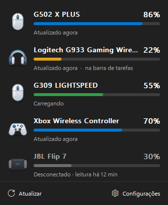
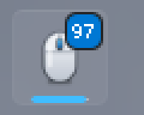
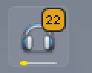
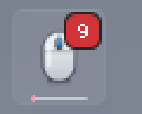
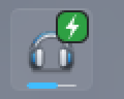
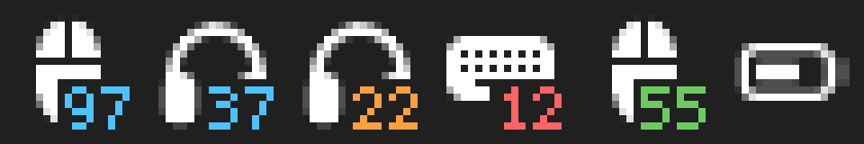
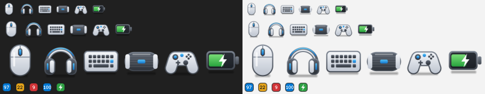
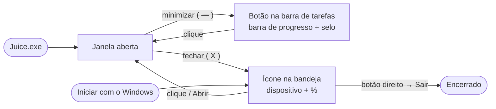

<p align="center">
  <a href="README.md">English</a> · <b>Português (Brasil)</b>
</p>

<p align="center">
  
</p>

<p align="center">
  <b>A bateria do seu mouse, teclado, headset, caixa de som e controle sem fio, direto na barra de tarefas do Windows.</b><br>
  Sem G HUB, sem serviço em segundo plano, sem instalador — um único <code>.exe</code> de ~410 KB.
</p>

<p align="center">
  <a href="https://github.com/gSalzmann/juice/releases/latest/download/Juice.exe"></a>
  <br><sub>Windows 10/11 x64 · <a href="https://github.com/gSalzmann/juice/releases/latest">notas da versão</a> · compilado a partir do código pelo <a href="https://github.com/gSalzmann/juice/actions/workflows/build.yml">GitHub Actions</a></sub>
</p>

<p align="center">
  
  
  
  
  <a href="LICENSE"></a>
</p>

---

## Por que "Juice"?

Em inglês, **juice** é gíria para *carga de bateria* — quem diz *"my phone is running out of juice"* está
dizendo que o celular está ficando sem bateria. O logo brinca com isso: a bateria é uma caixinha de suco
com canudo, e a carga é o suco que enche a caixinha (e as letras do nome) até aparecer o raio de carga cheia.

## O que ele faz

O Juice lê o nível de bateria de mouses, teclados, headsets, fones, caixas de som JBL, AirPods e controles de
Xbox e PlayStation sem fio — direto do hardware, sem o software do fabricante — e mostra no lugar mais visível do
Windows: **o botão do próprio app na barra de tarefas**.

- 🔋 **Barra de progresso do botão = % de bateria**, colorida pela faixa de carga
- 🔢 **Selo no ícone** com o número (ou um raio quando está carregando)
- 🖱️ **Ilustração do dispositivo** como ícone do botão (mouse, headset, teclado, caixa de som, controle)
- 🪟 **Janela compacta** com todos os dispositivos, nível, status e horário da última leitura
- ⏳ **Estimativa de duração** ("~2 dias restantes") pela velocidade com que o nível cai
- 🕓 **Último nível conhecido** dos dispositivos desconectados, em cinza, guardado entre reinícios
- ✖️ **Remover** pela própria janela um dispositivo que você não usa mais
- 📥 **Fechou a janela? Vai para a bandeja**, com o ícone do dispositivo e o percentual em pixel-art — um
  ícone, ou um por dispositivo
- 🔔 **Notificações** quando a bateria fica baixa e quando um dispositivo termina de carregar
- 💾 **Modo portátil**: as configurações ficam ao lado do `.exe`
- 🔁 **Vários dispositivos**: mostra o de menor bateria, um fixo, ou alterna entre todos a cada minuto
- 🪶 **Leve de verdade**: Win32 puro, sem runtime, ~0,2 MB de memória na bandeja
- 🌐 **Português e inglês**: segue automaticamente o idioma de exibição do Windows

## Como fica

### A janela



Cada linha mostra o dispositivo, o percentual, uma barra no tom da faixa de carga e o status
(*Atualizado agora*, *~2 dias restantes*, *Carregando*, *Em repouso · leitura há 12 min*, *Desconectado ·
leitura há 2 h*; nos fones, *E 80% · D 70% · estojo 50%*). A estimativa aparece depois que o nível cai pelo
menos 5 pontos desde a última carga. O dispositivo marcado com **· na barra de tarefas** é o que está no botão. Um dispositivo desconectado continua
com o último nível em cinza (dá para desligar nas configurações); passe o mouse sobre ele e clique no **×**
para tirá-lo da lista — ele volta sozinho se conectar de novo. Atalhos: <kbd>F5</kbd> atualiza,
<kbd>Esc</kbd> minimiza.

### O botão na barra de tarefas

| Normal | Bateria baixa | Crítica | Carregando |
|:---:|:---:|:---:|:---:|
|  |  |  |  |
| ≥ 30% · azul | 15–29% · amarelo | < 15% · vermelho | qualquer nível · verde + ⚡ |

A barra de progresso usa os estados nativos do Windows (normal, pausado e erro), então o azul acompanha a
cor de destaque do sistema. O selo pode ser desligado nas configurações — aí fica só a barra (o raio de
carregamento continua aparecendo).

> Capturas reais do Windows 11. O título da janela também mostra o valor: `G502 X PLUS — 92%`.

### A bandeja

Ao **fechar** a janela (X), o Juice continua rodando na área de notificação. O ícone mostra o mesmo
dispositivo da barra de tarefas, com o número desenhado em dígitos de 4×6 pixels para ficar legível em 16 px:



<sub>Ampliado 10×. Com "Colorir o número" ligado: azul ≥ 30%, laranja 15–29%, vermelho &lt; 15%, verde carregando.
Desligado, o número segue o tema da barra e só fica vermelho no nível crítico e verde ao carregar.</sub>

- **Clique** no ícone: reabre a janela
- **Botão direito**: Abrir · Atualizar agora · Configurações · Sair
- Passe o mouse para ver **todos** os dispositivos no tooltip
- Com *Um ícone na bandeja para cada dispositivo* ligado, cada dispositivo conectado ganha seu ícone (mesmo clique e menu)

### As ilustrações

Desenhadas em código por um pequeno renderizador vetorial (SDF com anti-aliasing e gradientes), nítidas
em qualquer tamanho e escala de tela, nos temas escuro e claro:



## Fluxo da janela



Abrir o `Juice.exe` de novo com ele já rodando apenas traz a janela existente de volta.

## Dispositivos suportados

| Fonte | Como o Juice lê | Testado com |
|---|---|---|
| **Logitech HID++ 2.0** — receptores LIGHTSPEED, Unifying e Bolt, Bluetooth e USB direto | features `0x1004` (UnifiedBattery), `0x1000`, `0x1001` (tensão → %) e `0x1F20` (headsets) | G502 X PLUS (LIGHTSPEED), G309 (LIGHTSPEED e Bluetooth), G933 |
| **Fones e headsets Bluetooth** que informam a bateria ao Windows (HFP) | propriedade de bateria que o próprio stack Bluetooth do Windows expõe | Galaxy Buds2, Galaxy Buds3 Pro |
| **Caixas de som JBL** *(opcional, desligado por padrão)* | serviço de controle Bluetooth LE da JBL — o mesmo do app JBL Portable ([protocolo do JBLControl](https://github.com/ffrafat/JBLControl)) | JBL Flip 7 |
| **Controle Xbox Wireless** pelo Bluetooth | o relatório de bateria que o controle envia sozinho a cada ~20 s (4 níveis: 10/40/70/100%) | controle do Xbox One S |
| **Controles PlayStation** pelo Bluetooth — DualSense, DualSense Edge, DualShock 4 | o campo de bateria do relatório completo do controle (layout do `hid-playstation` do Linux e do SDL) | *ainda não testado* |
| **AirPods e Beats** *(opcional, desligado por padrão)* | o anúncio Bluetooth LE da Apple, que traz cada fone e o estojo (layout do OpenPods / AirPodsDesktop); não precisa conectar | *ainda não testado* |

O tipo de cada dispositivo (mouse, teclado, headset, caixa de som, controle) e o nome são descobertos
automaticamente — via feature `0x0005` do HID++ ou pela classe do dispositivo Bluetooth — e lembrados, então um
dispositivo desconectado mantém o ícone.

**Uma linha por aparelho:** dispositivos Logitech são identificados pelo número de série, então um mouse que
funciona tanto pelo dongle quanto pelo Bluetooth (como o G309) vira uma linha só, e dois receptores do mesmo
modelo nunca misturam seus dispositivos.

**Caixas JBL** aceitam uma conexão de controle por vez: enquanto o app JBL Portable do celular estiver
conectado à caixa, o Juice não consegue ler. **Controles de Xbox** só enviam a bateria a cada ~20 s, então logo
depois de conectar pode levar esse tempo para aparecer. **AirPods** aparecem numa linha com o fone que acaba
primeiro; como os AirPods de qualquer pessoa por perto anunciam do mesmo jeito, o Juice só aceita sinais fortes
(perto do PC) e o par mais próximo de cada modelo, e os níveis vêm de 10 em 10%. Caixas de som que não informam
a bateria ao Windows e não têm protocolo conhecido simplesmente não aparecem.

**Dispositivos que dormem:** mouses Logitech parados entram em repouso e param de responder. O Juice mantém
o último valor por até 1 hora, marcado como *Em repouso · leitura há X min*, em vez de mostrar o
dispositivo como desconectado.

**Atualização:** a leitura roda numa thread separada no intervalo configurado, e também logo depois de
conectar/desconectar um dispositivo ou de o PC voltar da suspensão.

## Configurações

Clique em **Configurações** na janela ou no menu da bandeja. A tela segue o tema claro/escuro do Windows.

| Seção | Opção | Padrão | O que faz |
|---|---|---|---|
| Dispositivos | Na barra de tarefas | Automático | *Automático* = o de menor bateria (prioriza os que não estão carregando) · *Todos* = alterna entre os conectados a cada minuto · ou um dispositivo fixo |
| | Lista de dispositivos | todos marcados | Desmarque para esconder um dispositivo da janela, da barra e da bandeja |
| | Mostrar o último nível dos desconectados | ligado | Mantém a última leitura em cinza, com há quanto tempo foi lida |
| | Ler caixas de som JBL (Bluetooth LE) | desligado | Escuta por ~5 s a cada atualização e conecta nas caixas para ler o nível (~2 MB a mais de memória) |
| | Ler AirPods e fones Beats (Bluetooth LE) | desligado | Lê pelos anúncios, na mesma janela de escuta (~2 MB a mais de memória) |
| Ícones | Percentual no ícone da barra de tarefas | ligado | Liga/desliga o selo com o número |
| | Colorir o número da bandeja pelo nível | desligado | Azul / laranja / vermelho em vez da cor neutra |
| | Um ícone na bandeja para cada dispositivo | desligado | Um ícone por dispositivo conectado, em vez de um só com o da barra de tarefas |
| Atualização e avisos | Atualizar a cada | 5 min | Intervalo entre leituras (1–60 min) |
| | Avisar quando a bateria ficar abaixo de | 15% | Notificação do Windows, uma vez por descarga |
| | Avisar quando terminar de carregar | ligado | Notificação do Windows quando um dispositivo carregando chega a 100%, uma vez por carga |
| Geral | Iniciar com o Windows (na bandeja) | desligado | Usa `HKCU\Software\Microsoft\Windows\CurrentVersion\Run` — não precisa de administrador |

Tudo fica em `%APPDATA%\Juice\juice.ini` (texto simples, pode ser apagado para voltar ao padrão).

**Modo portátil:** se existir um `juice.ini` na mesma pasta do `Juice.exe` (pode ser um arquivo vazio), o Juice
usa esse arquivo — útil num pendrive.

> **Windows 11:** ícones novos da bandeja vão para a área oculta (^). Para deixar o Juice sempre visível:
> *Configurações → Personalização → Barra de tarefas → Outros ícones da bandeja do sistema*.

## Linha de comando

| Argumento | Efeito |
|---|---|
| `--tray` | Inicia direto na bandeja (é o que o "Iniciar com o Windows" usa) |
| `--demo 22` | Modo de teste: simula 22% no dispositivo da barra, num botão separado do app normal |
| `--demo 80c` | Idem, carregando |
| `--lang pt` / `--lang en` | Força o idioma da interface (por padrão segue o idioma de exibição do Windows: português se o Windows estiver em português, inglês nos demais) |

No modo de teste, com a janela em foco, <kbd>↑</kbd>/<kbd>↓</kbd> mudam o nível em 5% e <kbd>C</kbd>
liga/desliga o carregamento — útil para ver todas as cores e o aviso de bateria baixa sem esperar a
bateria descarregar.

## Compilar

Requisitos: **Visual Studio Build Tools 2022** com o workload *Desenvolvimento para desktop com C++*.

```bat
build.bat
```

O script encontra o MSVC sozinho (via `vswhere`) e gera em `build\`:

| Arquivo | Para quê |
|---|---|
| `Juice.exe` | o app |
| `probe.exe` | diagnóstico no terminal: lista cada interface HID++, dispositivo Bluetooth, caixa JBL, AirPods/Beats e controle, e as baterias lidas |
| `iconpreview.exe` | renderiza os ícones da bandeja ampliados num BMP |
| `illustpreview.exe` | renderiza as ilustrações e os selos num BMP |

Compilado com `/O1 /GL /LTCG` e CRT estática (`/MT`): não precisa de nenhum redistribuível instalado. O leitor
Bluetooth LE (JBL, AirPods) usa a API do Windows Runtime via C++/WinRT (cabeçalhos do Windows SDK, sem DLL
extra).

Cada push é compilado pelo [GitHub Actions](.github/workflows/build.yml), e o `Juice.exe` de cada release é
compilado lá a partir do código da tag e publicado com o SHA-256 (`Juice.exe.sha256`).

### Estrutura

```
src/
  juice.cpp      janela, botão da barra de tarefas, bandeja, configurações
  devices.*      lista de dispositivos, leitura em segundo plano, repouso e avisos
  hidpp.*        protocolo Logitech HID++ 2.0 sobre HID do Windows
  btbattery.*    bateria de dispositivos Bluetooth via propriedades do sistema
  ble.*          Bluetooth LE: caixas JBL e AirPods/Beats (C++/WinRT)
  pads.*         controles de Xbox e PlayStation: leitor em segundo plano dos relatórios de bateria
  illust.*       renderizador SDF: ilustrações, selos e barras da janela
  icon.*         ícones da bandeja (glifo + dígitos 4×6)
  config.*       juice.ini, modo portátil e início automático
  juice.ico      ícone do programa (fonte: docs/img/icon.svg) · version.h: número da versão
tools/           probe e geradores de preview
packaging/       manifestos do winget
docs/img/        imagens deste README
```

## Diagnóstico

Se um dispositivo não aparecer, rode `build\probe.exe` com ele ligado. A saída mostra cada receptor e slot
encontrado, as features HID++ usadas e o resultado da leitura — por exemplo `no response (asleep?)` para um
mouse em repouso, ou o erro devolvido por um headset desligado. Ele também procura caixas JBL e AirPods/Beats,
e espera até 25 s pelo relatório de bateria dos controles.

## Privacidade

O Juice não acessa a internet, não coleta nada e não instala serviços. Ele só conversa com os seus
dispositivos pelas APIs HID e Bluetooth do próprio Windows e grava um arquivo `.ini` na sua pasta de usuário.
Ele só escuta anúncios Bluetooth LE quando a opção da JBL ou dos AirPods está ligada, e só se conecta a caixas JBL.

## Histórico e próximos passos

Veja o [CHANGELOG.md](CHANGELOG.md) para o que mudou em cada versão e o [ROADMAP.md](ROADMAP.md) para o que está planejado.

## Licença

[MIT](LICENSE) — use, modifique e distribua à vontade, mantendo o aviso de copyright.
